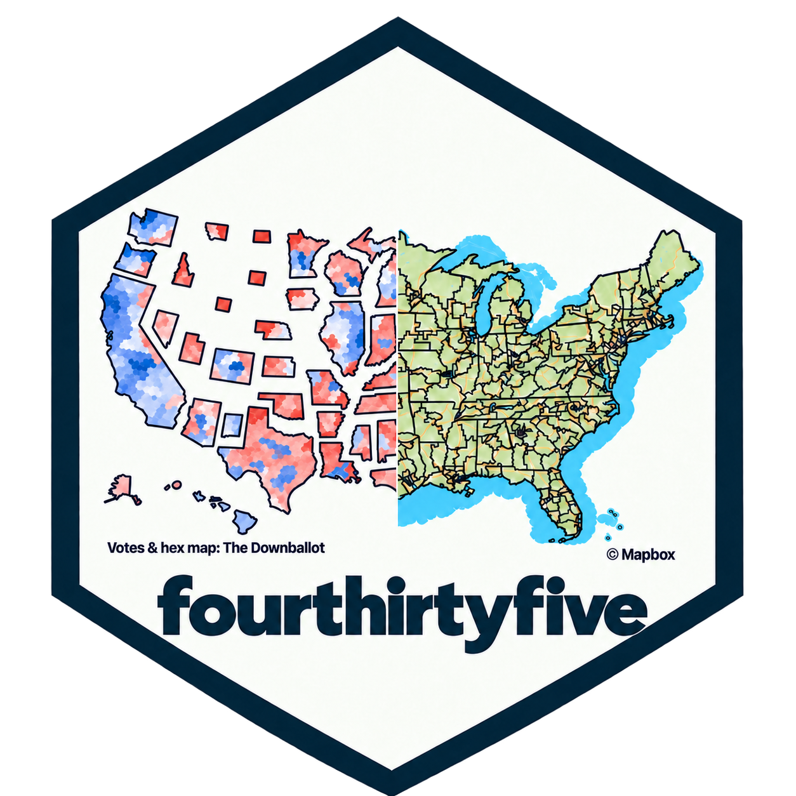
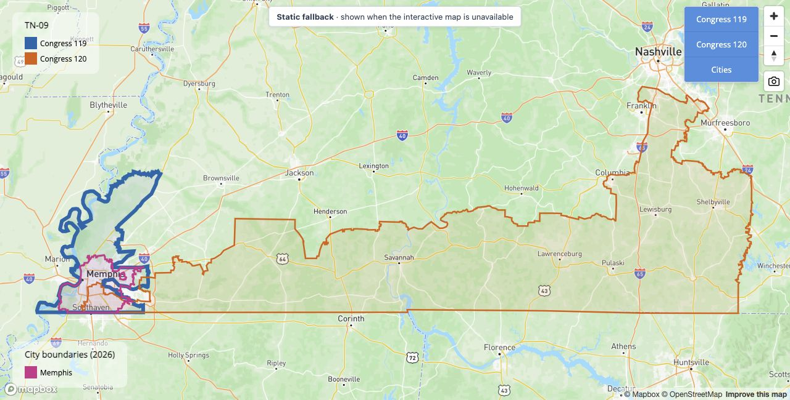
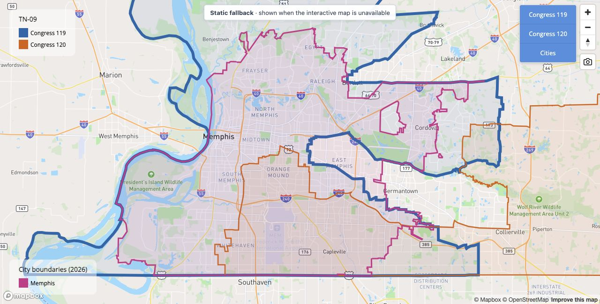

<!-- README.md is generated from README.Rmd. Please edit that file -->

```{r setup, include = FALSE}
knitr::opts_chunk$set(
  collapse = TRUE,
  comment = "#>",
  fig.path = "man/figures/README-",
  out.width = "100%"
)

# Website widgets ----

interactive_maps <- isTRUE(getOption("fourthirtyfive.website", FALSE)) &&
  startsWith(Sys.getenv("MAPBOX_PUBLIC_TOKEN"), "pk.")

render_map_widget <- function(x, options, ...) {
  map_file <- glue::glue("{options$label}.html")
  screenshot_file <- glue::glue("README-{options$label}.jpg")
  map_dir <- file.path("pkgdown", "assets", "maps")
  dir.create(map_dir, recursive = TRUE, showWarnings = FALSE)
  if (!file.copy(
    file.path("man", "figures", screenshot_file), map_dir, overwrite = TRUE
  )) {
    stop("Could not copy the interactive map's fallback screenshot.")
  }
  fallback_dependency <- htmltools::htmlDependency(
    name = "cd-map-fallback", version = "1.0.0",
    src = c(file = normalizePath("pkgdown")),
    script = "extra.js", stylesheet = "extra.css",
    all_files = FALSE
  )
  fallback_figure <- htmltools::attachDependencies(
    htmltools::tags$figure(
      class = "cd-map-fallback",
      htmltools::tags$img(src = screenshot_file, alt = options$fig.alt),
      htmltools::tags$figcaption(
        "Fallback screenshot \u2014 the interactive mapgl map is unavailable."
      )
    ),
    fallback_dependency
  )
  map_with_fallback <- htmlwidgets::prependContent(x, fallback_figure)
  htmlwidgets::saveWidget(
    map_with_fallback, file.path(map_dir, map_file),
    selfcontained = FALSE, libdir = "lib",
    title = options$fig.alt
  )
  knitr::asis_output(as.character(htmltools::tags$div(
    class = "cd-map-frame",
    htmltools::tags$iframe(
      class = "cd-map-iframe",
      src = glue::glue("maps/{map_file}"), title = options$fig.alt,
      width = "100%", height = "650", style = "border: 0;", loading = "lazy"
    ),
    htmltools::tags$figure(
      class = "cd-map-outer-fallback",
      htmltools::tags$img(
        src = file.path("man", "figures", screenshot_file),
        alt = options$fig.alt
      ),
      htmltools::tags$figcaption(
        "Fallback screenshot \u2014 the interactive mapgl map is unavailable."
      )
    )
  )))
}
```

# fourthirtyfive 

<!-- badges: start -->
[](https://github.com/kuriwaki/fourthirtyfive/actions/workflows/R-CMD-check.yaml)
[](https://github.com/kuriwaki/fourthirtyfive/tree/main/data)
[](https://github.com/kuriwaki/fourthirtyfive/tree/main/data)
[](https://github.com/kuriwaki/fourthirtyfive/tree/main/data)
<!-- badges: end -->


`fourthirtyfive` is a R library collecting shapefiles, CD descriptors, and other data for the 435 congressional districts in the U.S. House, gathering good ideas from various authors.

It is created and maintained by [Shiro Kuriwaki](https://www.shirokuriwaki.com), with contributions from Cory McCartan, Zachary Donnini, Zoya Ahmer, featuring data made generously public by Jeffrey Lewis, [The Downballot](https://www.the-downballot.com/p/data), and others. It also plays well with a standardized set of candidate election results and incumbency information, [CAGE](https://dataverse.harvard.edu/dataset.xhtml?persistentId=doi:10.7910/DVN/DGDRDT).


## Installation

You can install the development version of fourthirtyfive from [GitHub](https://github.com/) with:

``` r
# install.packages("devtools")
remotes::install_github("kuriwaki/fourthirtyfive")
```


## Examples

Use the `cd_` functions to retrieve district data. Type `cd_` in RStudio to discover the family with autocomplete.

```{r example}
library(fourthirtyfive)
```

| Function | Returns |
|---|---|
| `cd_boundaries()` | Geographic district boundaries as an `sf` object |
| `cd_dotmap()` | Dodged district points as an `sf` object |
| `cd_hexmap()` | District hex cartograms as an `sf` object |
| `cd_names()` | Descriptive geographical district names as a tibble |
| `cd_normal_vote()` | Independently calculated presidential partisan lean, with source gaps flagged |
| `cd_available()` | A CLI summary and an invisible availability table |

### Dot maps

We provide several types of maps. First, the **dotmap** is where one CD is treated as a point. We use the centroid of the actual map, and dodge it so that crowded points do not completely overlap with each other.

```{r dotmap}
library(sf)
library(ggplot2)

cd_dotmap(2023) |>
  ggplot() +
  geom_sf(data = shp_states) +
  geom_sf(size = 1, alpha = 0.5) +
  theme_void()
```


### Hex maps

We also provide **hexmaps** (i.e., maps that present CDs as combinations of hexagons) for Congresses starting in 2005–2027. The 2013–2027 maps are sourced from the Downballot's hex map shapefiles (<https://the-db.co/maps>). The 2005–2011 maps reuse a 2009 map generated with Cory McCartan's [hexmap](https://github.com/CoryMcCartan/hexmap) package. The 2013–2021 maps also reuse one cartogram, so these historical hexmaps do not capture every mid-decade boundary change.

```{r hexmap}
cd_hexmap(2023) |>
  ggplot() +
  geom_sf() +
  theme_void() +
  labs(caption = "Map Source: https://the-db.co/maps")
```

Note: An earlier version of these hex maps was provided in the [`donnermap`](https://github.com/kuriwaki/donnermap) package. Those shapefiles used unprojected coordinates that do not match the coordinate system of the other hex maps here. The hex maps in `fourthirtyfive` use the projected Web Mercator versions (`wm` suffix) from the Downballot.


### Boundary maps

We do not store actual CD shapefiles, but we provide a function to draw these from either the Census or Jeff Lewis's historical shapefiles.

```{r load-boundaries, include = FALSE}
suppressMessages(cd_shps <- cd_boundaries(congress = 118))
```

```{r boundaries-example, eval=FALSE}
cd_shps <- cd_boundaries(congress = 118)
```

```{r boundaries}
cd_shps |>
  ggplot() +
  geom_sf() +
  theme_void()
```

We can compare Tennessee's district boundaries for the 119th and 120th Congresses.
The maps use the same extent and district colors, with the 119th Congress on the
left and the 120th on the right.

```{r tn-boundaries, fig.width=12, fig.height=4, message=FALSE, echo=FALSE}
library(patchwork)

tn_boundaries <- cd_boundaries(congress = c(119, 120), state = "TN")
tn_extent <- st_bbox(tn_boundaries)

plot_tn <- function(congress_number, title) {
  tn_boundaries |>
    dplyr::filter(.data$congress == congress_number) |>
    ggplot(aes(fill = cd)) +
    geom_sf(color = "white", linewidth = 0.35) +
    geom_sf_text(aes(label = stringr::str_remove(cd, "^TN-0?")), size = 3) +
    scale_fill_brewer(palette = "Set3", guide = "none") +
    coord_sf(
      xlim = unname(tn_extent[c("xmin", "xmax")]),
      ylim = unname(tn_extent[c("ymin", "ymax")]),
      expand = FALSE
    ) +
    labs(title = title) +
    theme_void() +
    theme(plot.title = element_text(face = "bold", size = 13))
}

tn_119 <- plot_tn(119, "119th Congress (2025-2026)")
tn_120 <- plot_tn(120, "120th Congress (2027-2028)")

(tn_119 | tn_120) +
  plot_annotation(
    title = "Tennessee congressional districts",
    caption = "Source: U.S. Census Bureau via tigris. 119th: 2024 cartographic boundaries;\n120th: 2026 TIGER/Line boundaries, simplified for display. Colors identify district numbers."
  )
```

### Interactive comparisons

Mapbox is a recent tool that allows for _interactive_ maps, so users can zoom into particular
places and overlay them with real city names. The package provides a wrapper, 
[`cd_mapbox()`](https://www.shirokuriwaki.com/fourthirtyfive/reference/cd_mapbox.html),
to do this. This tool is useful too to compare how much of a district overlaps
with a city, or how redistricting has changed.

For example, compare Tennessee's 9th district, represented by
[Steve Cohen](https://clerk.house.gov/members/C001068) in the 119th Congress,
between the 2025 and 2027 maps.

```{r tn-interactive, eval=interactive_maps, render=render_map_widget, message=FALSE, fig.alt="Tennessee's 9th district in the 119th and 120th Congresses, with Memphis highlighted"}
cd_mapbox(cd = "TN-09", congress = c(119, 120), cities = "Memphis", detailed = TRUE)
```

```{asis tn-interactive-link, echo=!interactive_maps}
[Explore the interactive district comparison on the package website.](https://www.shirokuriwaki.com/fourthirtyfive/#interactive-comparisons)

<details class="map-fallback-details">
<summary>Show fallback screenshot (interactive mapgl is unavailable here)</summary>



</details>
```

We can zoom to Memphis by default too:

```{r memphis-interactive, eval=interactive_maps, render=render_map_widget, message=FALSE, fig.alt="Memphis city boundaries with TN-09 in the 119th and 120th Congresses overlaid"}
cd_mapbox(cd = "TN-09", congress = c(119, 120), cities = "Memphis", zoom_to_cities = TRUE, detailed = TRUE)
```

```{asis memphis-interactive-link, echo=!interactive_maps}
[Explore the interactive Memphis view on the package website.](https://www.shirokuriwaki.com/fourthirtyfive/maps/memphis-interactive.html)

<details class="map-fallback-details">
<summary>Show fallback screenshot (interactive mapgl is unavailable here)</summary>



</details>
```

`detailed = TRUE` (the default) uses full-resolution Census TIGER/Line district
boundaries for these interactive maps, including the 119th Congress. Use
`detailed = FALSE` for smaller, generalized maps. Historical boundary precision
still depends on the original source.

These interactive maps require the optional `mapgl` package and a Mapbox public token.
See the [Mapbox setup guide](https://www.shirokuriwaki.com/fourthirtyfive/reference/mapbox-setup.html)
for installation, token configuration, and usage limits, or run
`help("mapbox-setup", package = "fourthirtyfive")` in R.

### Descriptive Names 

We also provide a dataset of the **descriptive names** of each district (e.g., calling AZ-01 in the 110th Congress "Phoenix exurbs, Prescott, and Flagstaff").
These use [Daily
Kos](https://www.dailykos.com/stories/2022/8/8/2113098/community/The-Daily-Kos-Elections-naming-guide-to-this-decade-s-new-congressional-districts/) names. Zachary Donnini supplied the 2005–2011 names. 


```{r district-names}
cd_names(2007)
```


### Normal vote

Use `cd_normal_vote()` to retrieve an independently calculated measure of
presidential partisan lean. The calculation follows the publicly documented
75/25 methodology of the well-known [Cook Partisan Voting Index
(Cook PVI)](https://www.cookpolitical.com/cook-pvi).
It averages the district's Democratic two-party
vote share relative to the national share in the two most recent presidential
elections, weighting the newer election 75% and the older election 25%.
`+0.05` thus indicates five percentage points more Democratic than the nation, and
`-0.05` indicates five points more Republican.

The map below uses the **2024** election's district boundaries, corresponding
to `year = 2025` / the 119th Congress, with 2020 and 2024 presidential returns
available for all 435 districts. Cook's PVI for the 2027 map can be obtained from their  [website](https://www.cookpolitical.com/cook-pvi) but we do not download them here due to their stringent IP rules.

<details>
<summary>Show the R code for the normal-vote map</summary>

```{r normal-vote-hexmap-code, eval=FALSE}
library(dplyr)
library(ggplot2)

hex_normal_vote <- cd_hexmap(year = 2025) |>
  left_join(
    cd_normal_vote(year = 2025) |> select(cong, cd, normal_vote),
    by = c("cong", "cd"), relationship = "one-to-one"
  ) |>
  mutate(state = substr(cd, 1, 2))

ggplot(hex_normal_vote) +
  ggredist::geom_district(
    aes(group = cd, fill = normal_vote), color = "white", linewidth = 0.1
  ) +
  ggredist::geom_district(
    aes(group = state), fill = NA, color = "grey40", linewidth = 0.25,
    show.legend = FALSE
  ) +
  labs(title = "Normal vote, 2024 election map") +
  ggredist::scale_fill_party_c(
    name = "Normal vote", midpoint = 0, limits = c(-0.4, 0.4),
    labels = ggredist::label_party_margin(midpoint = 0)
  ) +
  ggredist::theme_map(
    text = element_text(family = "sans", size = 11, color = "black"),
    plot.title = element_text(size = 12, hjust = 0.5),
    legend.position = "bottom",
    legend.title.position = "top",
    legend.text = element_text(size = 11, color = "black"),
    legend.title = element_text(size = 11, color = "black"),
    legend.key.width = grid::unit(1.2, "cm"),
    legend.key.height = grid::unit(0.25, "cm"),
    plot.margin = margin(2, 2, 2, 2)
  )
```

</details>

```{r normal-vote-hexmap, ref.label="normal-vote-hexmap-code", echo=FALSE, fig.width=5, fig.height=3, dev="ragg_png", dpi=300, fig.retina=1, message=FALSE, fig.alt="2024 election House hex map colored by independently calculated normal vote: Republican-leaning districts in red, Democratic-leaning districts in blue, with state outlines."}
```


## Year definition and availability

We name the datasets (`shp_dot_**`, `info_**`) by the year of the congress.

|Object | Congress | Years in Session | Year Elected | Year up for Election | 
|-------|----------|-------|---------------|----------|
|`**_2005` | 109th | 2005-2006 | 2004 | 2006 |
|`**_2007` | 110th | 2007-2008 | 2006 | 2008 |
|`**_2009` | 111th | 2009-2010 | 2008 | 2010 |
|`**_2011` | 112th | 2011-2012 | 2010 | 2012 |
|`**_2013` | 113th | 2013-2014 | 2012 | 2014 | 
|`**_2015` | 114th | 2015-2016 | 2014 | 2016 |
|`**_2017` | 115th | 2017-2018 | 2016 | 2018 |
|`**_2019` | 116th | 2019-2020 | 2018 | 2020 |
|`**_2021` | 117th | 2021-2022 | 2020 | 2022 |
|`**_2023` | 118th | 2023-2024 | 2022 | 2024 |
|`**_2025` | 119th | 2025-2026 | 2024 | 2026 |
|`**_2027` | 120th | 2027-2028 | 2026 | 2028 |

Currently most of the function covers the years above. You can run the following function for an overview:

```{r}
fourthirtyfive::cd_available()
```


## AI assistance for this package

Frontier AI models wrote a large share of package code, documentation,
data collection and preparation, and checks of district descriptions and map
geometry. These contributions are documented in the public Github source code. 
The human authors reviewed the output and core functionalities of the code, to vouch for the package's content
and accuracy. Data sources and contributors are credited in the relevant
documentation.
