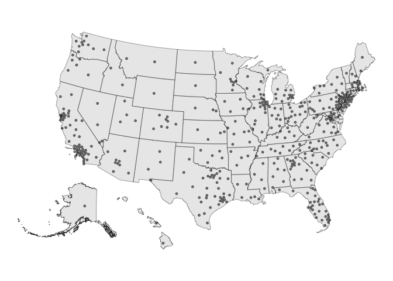
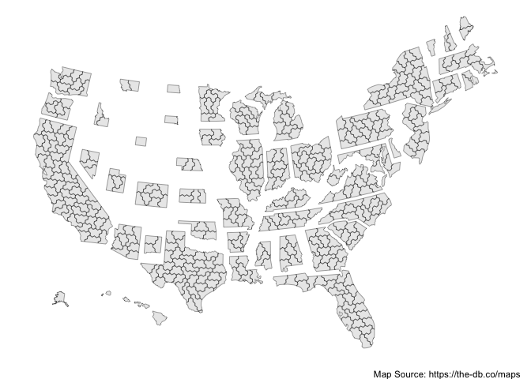
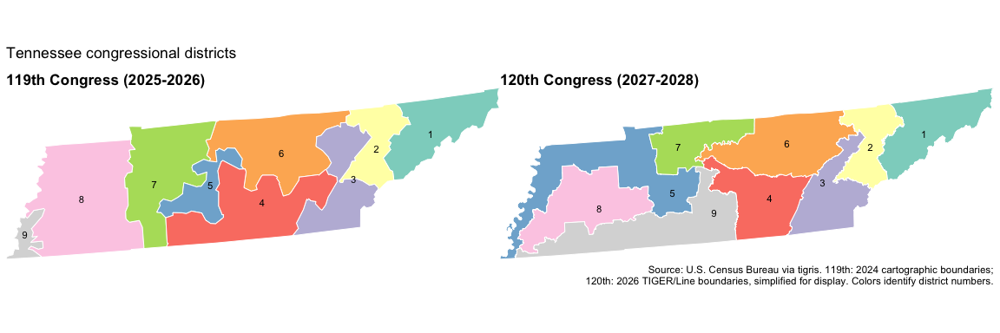
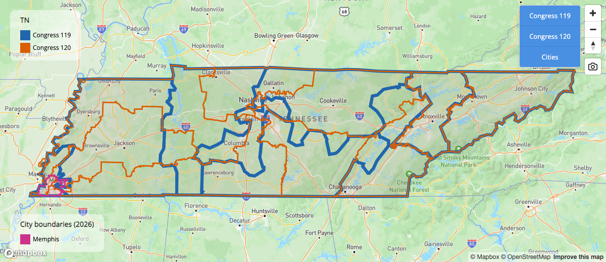
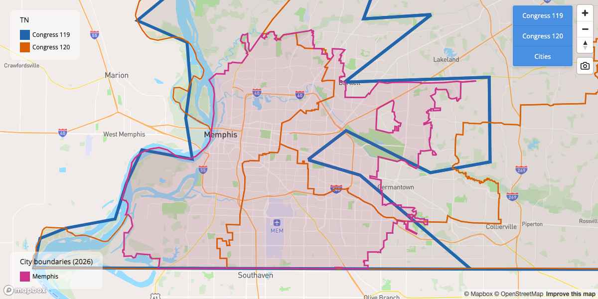
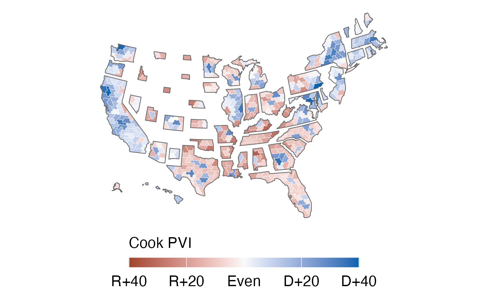

<!-- README.md is generated from README.Rmd. Please edit that file -->

# fourthirtyfive

<!-- badges: start -->

[](https://github.com/kuriwaki/fourthirtyfive/actions/workflows/R-CMD-check.yaml)
[](https://github.com/kuriwaki/fourthirtyfive/tree/main/data)
[](https://github.com/kuriwaki/fourthirtyfive/tree/main/data)
[](https://github.com/kuriwaki/fourthirtyfive/tree/main/data)
<!-- badges: end -->

Creator / Maintainer: Shiro Kuriwaki

Contributors: Zoya Ahmer, Zachary Donnini, Cory McCartan

Copyright holders: Downballot and Cook Political Report (some data)

`fourthirtyfive` is a package that provides shapefiles and other data
for the 435 congressional districts, gathering good ideas from various
authors.

## Installation

You can install the development version of fourthirtyfive from
[GitHub](https://github.com/) with:

``` r
# install.packages("devtools")
remotes::install_github("kuriwaki/fourthirtyfive")
```

Use `cd_available()` for the full coverage and main options:

``` r
fourthirtyfive::cd_available()
#> 
#> ── Available congressional district data ──
#> 
#> • `cd_boundaries()`: 1789-2027 (Congresses 1-120); Lewis / US Census.
#> • `cd_dotmap()`: 2005-2027 (Congresses 109-120); Lewis / US Census, dodged
#>   centroids.
#> • `cd_hexmap()`: 2005-2027 (Congresses 109-120); hexmap / The Downballot.
#> • `cd_names()`: 2005-2027 (Congresses 109-120); Daily Kos / The Downballot /
#>   contributors.
#> • `cd_pvi()`: 1999-2027 (Congresses 106-120); The Cook Political Report;
#>   public-source gaps are NA.
#> Years refer to the start of a Congress, not its election year.
#> Historical hexmaps for 2005-2011 reuse the generated 2009 map.
#> PVI tables flag unavailable and documented unchanged values; inspect their
#> status column.
```

## Example

Use the `cd_` functions to retrieve district data. Type `cd_` in RStudio
to discover the family with autocomplete.

``` r
library(fourthirtyfive)
```

| Function | Returns |
|----|----|
| `cd_boundaries()` | Geographic district boundaries as an `sf` object |
| `cd_dotmap()` | Dodged district points as an `sf` object |
| `cd_hexmap()` | District hex cartograms as an `sf` object |
| `cd_names()` | Descriptive geographical district names as a tibble |
| `cd_pvi()` | Historical Cook PVI labels, with public-source gaps flagged |
| `pvi_to_numeric()` | Cook PVI labels as signed proportions for either party |
| `cd_available()` | A CLI summary and an invisible availability table |

We provide several types of maps. First, the **dotmap** is where one CD
is treated as a point. We use the centroid of the actual map, and dodge
it so that crowded points do not completely overlap with each other.

``` r
library(sf)
#> Linking to GEOS 3.13.0, GDAL 3.8.5, PROJ 9.5.1; sf_use_s2() is TRUE
library(ggplot2)

cd_dotmap(2023) |>
  ggplot() +
  geom_sf(data = shp_states) +
  geom_sf(size = 1, alpha = 0.5) +
  theme_void()
```



Dotmaps are also available as bundled datasets:

``` r
shp_dot_2023
#> Simple feature collection with 435 features and 2 fields
#> Geometry type: POINT
#> Dimension:     XY
#> Bounding box:  xmin: -2288151 ymin: 118141.6 xmax: 2073753 ymax: 3105727
#> Projected CRS: NAD83 / Conus Albers
#> First 10 features:
#>    cong    cd                  geometry
#> 1   118 AK-01 POINT (-1935091 654711.3)
#> 2   118 AL-01 POINT (780145.2 921677.4)
#> 3   118 AL-02  POINT (934714.7 1007996)
#> 4   118 AL-03  POINT (947758.5 1172320)
#> 5   118 AL-04  POINT (799973.5 1270900)
#> 6   118 AL-05  POINT (852955.2 1339883)
#> 7   118 AL-06  POINT (851197.4 1185212)
#> 8   118 AL-07  POINT (783499.7 1078747)
#> 9   118 AR-01  POINT (421002.1 1377139)
#> 10  118 AR-02  POINT (328419.7 1351219)
```

We also provide **hexmaps** (i.e., maps that present CDs as combinations
of hexagons) for Congresses starting in 2005–2027. The 2013–2027 maps
are sourced from the Downballot’s hex map shapefiles
(<https://the-db.co/maps>). The 2005–2011 maps reuse a 2009 map
generated with Cory McCartan’s
[hexmap](https://github.com/CoryMcCartan/hexmap) package. The 2013–2021
maps also reuse one cartogram, so these historical hexmaps do not
capture every mid-decade boundary change.

``` r
cd_hexmap(2023) |>
  ggplot() +
  geom_sf() +
  theme_void() +
  labs(caption = "Map Source: https://the-db.co/maps")
```



Note: An earlier version of these hex maps was provided in the
[`donnermap`](https://github.com/kuriwaki/donnermap) package. Those
shapefiles used unprojected coordinates that do not match the coordinate
system of the other hex maps here. The hex maps in `fourthirtyfive` use
the projected Web Mercator versions (`wm` suffix) from the Downballot.

We do not store actual CD shapefiles, but we provide a function to draw
these from either the Census or Jeff Lewis’s historical shapefiles.

``` r
cd_shps <- cd_boundaries(congress = 118)
```

``` r
cd_shps |>
  ggplot() +
  geom_sf() +
  theme_void()
```


Compare Tennessee’s district boundaries for the 119th and 120th
Congresses. The maps use the same extent and district colors, with the
119th Congress above the 120th.

``` r
library(patchwork)

tn_boundaries <- cd_boundaries(congress = c(119, 120), state = "TN")
tn_extent <- st_bbox(tn_boundaries)

plot_tn <- function(congress_number, title) {
  tn_boundaries |>
    dplyr::filter(.data$congress == congress_number) |>
    ggplot(aes(fill = cd)) +
    geom_sf(color = "white", linewidth = 0.35) +
    geom_sf_text(aes(label = stringr::str_remove(cd, "^TN-0?")), size = 3) +
    scale_fill_brewer(palette = "Set3", guide = "none") +
    coord_sf(
      xlim = unname(tn_extent[c("xmin", "xmax")]),
      ylim = unname(tn_extent[c("ymin", "ymax")]),
      expand = FALSE
    ) +
    labs(title = title) +
    theme_void() +
    theme(plot.title = element_text(face = "bold", size = 13))
}

tn_119 <- plot_tn(119, "119th Congress (2025-2026)")
tn_120 <- plot_tn(120, "120th Congress (2027-2028)")

(tn_119 / tn_120) +
  plot_annotation(
    title = "Tennessee congressional districts",
    caption = "Source: U.S. Census Bureau via tigris. 119th: 2024 cartographic boundaries;\n120th: 2026 TIGER/Line boundaries, simplified for display. Colors identify district numbers."
  )
```



### Interactive comparisons

Use `cd_mapbox()` to overlay one to three Congresses on a single
interactive map. Select a state or a district, and use the map’s layer
controls to switch Congresses on and off. City boundaries are absent by
default; select one or two incorporated cities to highlight only those
cities in magenta.

Tennessee’s 119th and 120th Congresses, with Memphis highlighted:

``` r
cd_mapbox(state = "TN", congress = c(119, 120), cities = "Memphis")
```

<figure>

<figcaption aria-hidden="true">Tennessee with 119th-Congress boundaries
in blue, 120th-Congress boundaries in orange, and Memphis in
magenta.</figcaption>
</figure>

Zoom to Memphis while retaining both Congress layers:

``` r
cd_mapbox(
  state = "TN", congress = c(119, 120), cities = "Memphis",
  zoom_to_cities = TRUE
)
```

<figure>

<figcaption aria-hidden="true">Memphis city boundaries in magenta with
the 119th and 120th congressional districts overlaid.</figcaption>
</figure>

City outlines use the same 2026 Census geography in both views. District
boundary detail varies across Congresses, so small differences at street
scale may reflect cartographic generalization. The camera control saves
the current map as a PNG.

Interactive maps require the optional `mapgl` package and a Mapbox
public token. See the [Mapbox setup
guide](https://www.shirokuriwaki.com/fourthirtyfive/reference/mapbox-setup.html)
for installation, token configuration, and usage limits, or run
`help("mapbox-setup", package = "fourthirtyfive")` in R.

We also provide a dataset of the **descriptive names** of each district
(e.g., calling AZ-01 in the 110th Congress “Phoenix exurbs, Prescott,
and Flagstaff”). These use [Daily
Kos](https://www.dailykos.com/stories/2022/8/8/2113098/community/The-Daily-Kos-Elections-naming-guide-to-this-decade-s-new-congressional-districts/)
names. Zachary Donnini supplied the 2005–2011 names.

``` r
cd_names(2007)
#> # A tibble: 435 × 3
#>     cong cd    cd_description                                
#>    <dbl> <chr> <chr>                                         
#>  1   110 AK-01 All of Alaska                                 
#>  2   110 AL-01 Southern Alabama                              
#>  3   110 AL-02 Southeast Alabama                             
#>  4   110 AL-03 East-central Alabama                          
#>  5   110 AL-04 North-central Alabama                         
#>  6   110 AL-05 Northern Alabama                              
#>  7   110 AL-06 Birmingham and Tuscaloosa suburbs             
#>  8   110 AL-07 Birmingham, Tuscaloosa, and western Black Belt
#>  9   110 AR-01 Northeastern Arkansas                         
#> 10   110 AR-02 Greater Little Rock                           
#> # ℹ 425 more rows
```

The same district names are available as a bundled dataset:

``` r
info_2007
```

### Cook PVI

Use `cd_pvi()` to retrieve the data. See `?cd_pvi` for documentation and
`cd_available()` for coverage.

The map below shows Cook PVI for all 435 districts in the 120th Congress
(2027–2028), using the district maps for the 2026 election. Red
indicates a Republican lean and blue a Democratic lean. The legend is in
PVI points. The optional `ggredist` package supplies the district and
state outlines, partisan color scale, and legend labels; `midpoint = 0`
preserves the PVI scale.

PVI data: [The Cook Political
Report](https://www.cookpolitical.com/races), collected October 25,
2026. Hex cartogram: [The Downballot](https://the-db.co/maps), via
`cd_hexmap()`.

``` r
library(dplyr)
library(ggplot2)

hex_pvi <- cd_hexmap(year = 2027) |>
  left_join(
    cd_pvi(year = 2027) |> select(cong, cd, pvi),
    by = c("cong", "cd"), relationship = "one-to-one"
  ) |>
  mutate(pvi_D = pvi_to_numeric(pvi), state = substr(cd, 1, 2))

ggplot(hex_pvi) +
  ggredist::geom_district(
    aes(group = cd, fill = pvi_D), color = "white", linewidth = 0.1
  ) +
  ggredist::geom_district(
    aes(group = state), fill = NA, color = "grey40", linewidth = 0.25,
    show.legend = FALSE
  ) +
  ggredist::scale_fill_party_c(
    name = "Cook PVI", midpoint = 0, limits = c(-0.4, 0.4),
    labels = ggredist::label_party_margin(midpoint = 0)
  ) +
  ggredist::theme_map(
    text = element_text(family = "sans", size = 11, color = "black"),
    legend.position = "bottom",
    legend.title.position = "top",
    legend.text = element_text(size = 11, color = "black"),
    legend.title = element_text(size = 11, color = "black"),
    legend.key.width = grid::unit(1.2, "cm"),
    legend.key.height = grid::unit(0.25, "cm"),
    plot.margin = margin(2, 2, 2, 2)
  )
```



## Data format

We name the datasets (`shp_dot_**`, `info_**`) by the year of the
congress.

| Object    | Congress | Years in Session | Year Elected | Year up for Election |
|-----------|----------|------------------|--------------|----------------------|
| `**_2005` | 109th    | 2005-2006        | 2004         | 2006                 |
| `**_2007` | 110th    | 2007-2008        | 2006         | 2008                 |
| `**_2009` | 111th    | 2009-2010        | 2008         | 2010                 |
| `**_2011` | 112th    | 2011-2012        | 2010         | 2012                 |
| `**_2013` | 113th    | 2013-2014        | 2012         | 2014                 |
| `**_2015` | 114th    | 2015-2016        | 2014         | 2016                 |
| `**_2017` | 115th    | 2017-2018        | 2016         | 2018                 |
| `**_2019` | 116th    | 2019-2020        | 2018         | 2020                 |
| `**_2021` | 117th    | 2021-2022        | 2020         | 2022                 |
| `**_2023` | 118th    | 2023-2024        | 2022         | 2024                 |
| `**_2025` | 119th    | 2025-2026        | 2024         | 2026                 |
| `**_2027` | 120th    | 2027-2028        | 2026         | 2028                 |
