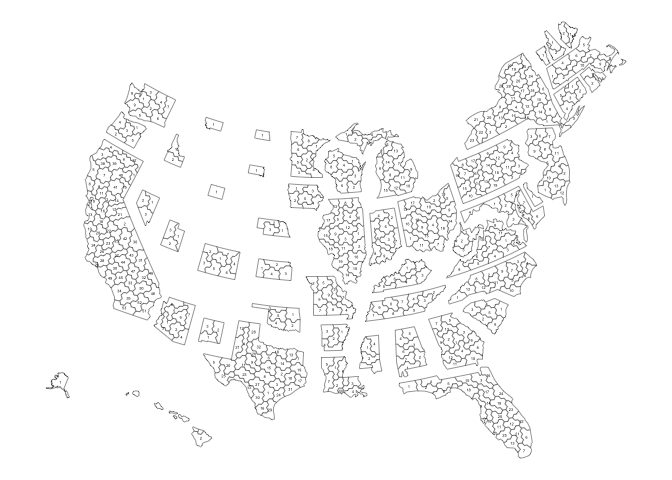

<!-- README.md is generated from README.Rmd. Please edit that file -->

# cdmap

<!-- badges: start -->

<!-- badges: end -->

cdmap is a package that provides a shapefile in hexagonal form as
inspired by the Daily Kos map style. It also provides descriptive names
for each district, as inspired by [Daily
Kos](https://www.dailykos.com/stories/2022/8/8/2113098/-The-Daily-Kos-Elections-naming-guide-to-this-decade-s-new-congressional-districts).

## Installation

You can install the development version of cdmap from
[GitHub](https://github.com/) with:

``` r
# install.packages("devtools")
remotes::install_github("kuriwaki/cdmap")
```

If you have the repository on your computer, you can open the Rstudio
Project (.Rproj) and use devtools:

``` r
devtools::load_all()
```

`load_all` is a fast way to get your changes implemented. To fully
install the changes installed and working across sessions, you will need
to install.

``` r
devtools::install()
```

Read more about the terms and customs for making a R package at
<https://r-pkgs.org/>.

## Example

The main output of the package is a dataset, which comes pre-loaded with
the package.

``` r
library(cdmap)
```

The package names the shapefiles by the year of the congress.

| Object    | Congress | Years in Session | Year Elected | Year up for Election |
|-----------|----------|------------------|--------------|----------------------|
| `**_2005` | 109th    | 2005-2006        | 2004         | 2006                 |
| `**_2007` | 110th    | 2007-2008        | 2006         | 2008                 |
| `**_2009` | 111th    | 2009-2010        | 2008         | 2010                 |
| `**_2011` | 112th    | 2011-2012        | 2010         | 2012                 |
| `**_2013` | 113th    | 2013-2014        | 2012         | 2014                 |
| `**_2015` | 114th    | 2015-2016        | 2014         | 2016                 |
| `**_2017` | 115th    | 2017-2018        | 2016         | 2018                 |
| `**_2019` | 116th    | 2019-2020        | 2018         | 2020                 |
| `**_2021` | 117th    | 2021-2022        | 2020         | 2022                 |
| `**_2023` | 118th    | 2023-2024        | 2022         | 2024                 |
| `**_2025` | 119th    | 2025-2026        | 2024         | 2026                 |

We are building several types of maps. The **dotmap** is where one CD is
treated as point. We use the centeroid of the actual map, and dodge it
so that crowded points do not completely overlap with each other.

``` r
library(sf)
#> Linking to GEOS 3.13.0, GDAL 3.8.5, PROJ 9.5.1; sf_use_s2() is TRUE
library(ggplot2)

shp_dot_2023 |>
  ggplot() +
  geom_sf(data = shp_states) +
  geom_sf(size = 1, alpha = 0.5)
```


Another is a hexmap, where each district is shown as a combination of
hexagons. This is inspired by the DailyKos format. For now, one test
dataset available.

``` r
c2009_shp
#> Simple feature collection with 435 features and 4 fields
#> Active geometry column: geometry
#> Geometry type: GEOMETRY
#> Dimension:     XY
#> Bounding box:  xmin: -2682394 ymin: -23773.04 xmax: 2541702 ymax: 3908262
#> Projected CRS: NAD83 / Conus Albers
#> First 10 features:
#>       cd state district                                        descrip
#> 1  AK-01    AK        1                                  All of Alaska
#> 2  AL-01    AL        1                               Southern Alabama
#> 3  AL-02    AL        2                              Southeast Alabama
#> 4  AL-03    AL        3                           East-central Alabama
#> 5  AL-04    AL        4                          North-central Alabama
#> 6  AL-05    AL        5                               Northern Alabama
#> 7  AL-06    AL        6              Birmingham and Tuscaloose suburbs
#> 8  AL-07    AL        7 Birmingham, Tuscaloosa, and western Black Belt
#> 9  AR-01    AR        1                          Northeastern Arkansas
#> 10 AR-02    AR        2                            Greater Little Rock
#>                          geometry                    center
#> 1  POLYGON ((-2681792 608199.3... POINT (-2554623 660630.1)
#> 2  POLYGON ((560812.3 712038.7... POINT (576211.9 791297.6)
#> 3  POLYGON ((749626.4 816329.6... POINT (686695.9 885543.9)
#> 4  POLYGON ((639697.2 959713, ... POINT (633454.5 998615.8)
#> 5  POLYGON ((485800.6 1003661,...  POINT (512519.9 1055698)
#> 6  POLYGON ((666169.5 1076799,...  POINT (593926.3 1100898)
#> 7  POLYGON ((577942.1 955522.2... POINT (538527.9 938058.6)
#> 8  POLYGON ((476010.1 839899.4... POINT (560392.8 863243.3)
#> 9  POLYGON ((5703.468 1040718,...  POINT (-15946.5 1114678)
#> 10 POLYGON ((-42911.85 1024085... POINT (-90424.92 1054591)
```

``` r
c2009_shp |> 
  ggplot() + geom_sf(fill = "white") + theme_void() +
  geom_sf_text(aes(label = district, geometry = center), size = 1)
```


