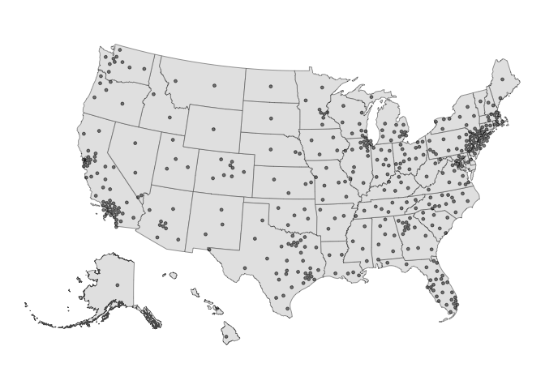

<!-- README.md is generated from README.Rmd. Please edit that file -->

# fourthirtyfive

Maintainer: Shiro Kuriwaki

<!-- badges: start -->

[](https://github.com/kuriwaki/fourthirtyfive/actions/workflows/R-CMD-check.yaml)
<!-- badges: end -->

fourthirtyfive is a package that provides shapefiles and other data for
congressional districts, 2006-2025.

## Installation

You can install the development version of fourthirtyfive from
[GitHub](https://github.com/) with:

``` r
# install.packages("devtools")
remotes::install_github("kuriwaki/fourthirtyfive")
```

## Example

The main output of the package are datasets which comes pre-loaded with
the package.

``` r
library(fourthirtyfive)
```

We are building several types of maps. First, the **dotmap** is where
one CD is treated as point. We use the centroid of the actual map, and
dodge it so that crowded points do not completely overlap with each
other.

``` r
library(sf)
#> Linking to GEOS 3.13.0, GDAL 3.8.5, PROJ 9.5.1; sf_use_s2() is TRUE
library(ggplot2)

load_shp_dot(2023) |>
  ggplot() +
  geom_sf(data = shp_states) +
  geom_sf(size = 1, alpha = 0.5) +
  theme_void()
```



For now, the output of each function for recent years is stored as a
package dataset as well:

``` r
shp_dot_2023
#> Simple feature collection with 435 features and 2 fields
#> Geometry type: POINT
#> Dimension:     XY
#> Bounding box:  xmin: -2288151 ymin: 118141.6 xmax: 2073753 ymax: 3105727
#> Projected CRS: NAD83 / Conus Albers
#> First 10 features:
#>    cong    cd                  geometry
#> 1   118 AK-01 POINT (-1935091 654711.3)
#> 2   118 AL-01 POINT (780145.2 921677.4)
#> 3   118 AL-02  POINT (934714.7 1007996)
#> 4   118 AL-03  POINT (947758.5 1172320)
#> 5   118 AL-04  POINT (799973.5 1270900)
#> 6   118 AL-05  POINT (852955.2 1339883)
#> 7   118 AL-06  POINT (851197.4 1185212)
#> 8   118 AL-07  POINT (783499.7 1078747)
#> 9   118 AR-01  POINT (421002.1 1377139)
#> 10  118 AR-02  POINT (328419.7 1351219)
```

We are currently working on providing **hexmaps** (i.e., maps that
present CDs as combinations of hexagons) for all years. A 2016-era
version of these versions are provided in
<https://github.com/kuriwaki/donnermap> and the Downballot links
recorded there.

``` r
library(donnermap) # remotes::install_github("kuriwaki/donnermap")

ggplot(cd_shp) +
  geom_sf() +
  theme_void() +
  labs(caption = "Map Source: http://dkel.ec/map")
```


We do not store actual CD shapefiles, but we provide a function to draw
these from either the Census or Jeff Lewis’s historical shapefiles.

``` r
cd_shps <- load_cd_shps(c = 118)
#>   |                                                                              |                                                                      |   0%  |                                                                              |==                                                                    |   3%  |                                                                              |====                                                                  |   6%  |                                                                              |=====                                                                 |   7%  |                                                                              |========                                                              |  11%  |                                                                              |==========                                                            |  14%  |                                                                              |============                                                          |  17%  |                                                                              |===============                                                       |  22%  |                                                                              |=================                                                     |  24%  |                                                                              |===================                                                   |  27%  |                                                                              |====================                                                  |  29%  |                                                                              |=======================                                               |  33%  |                                                                              |=========================                                             |  36%  |                                                                              |============================                                          |  41%  |                                                                              |=============================                                         |  42%  |                                                                              |===============================                                       |  44%  |                                                                              |==================================                                    |  48%  |                                                                              |====================================                                  |  52%  |                                                                              |======================================                                |  54%  |                                                                              |==========================================                            |  59%  |                                                                              |============================================                          |  63%  |                                                                              |===============================================                       |  68%  |                                                                              |==================================================                    |  72%  |                                                                              |=====================================================                 |  76%  |                                                                              |========================================================              |  80%  |                                                                              |===========================================================           |  84%  |                                                                              |==============================================================        |  88%  |                                                                              |================================================================      |  92%  |                                                                              |===================================================================   |  96%  |                                                                              |======================================================================| 100%
#> old-style crs object detected; please recreate object with a recent sf::st_crs()
#> Warning in CPL_crs_from_input(x): GDAL Message 1: CRS EPSG:2163 is deprecated.
#> Its non-deprecated replacement EPSG:9311 will be used instead. To use the
#> original CRS, set the OSR_USE_NON_DEPRECATED configuration option to NO.

cd_shps |>
  ggplot() +
  geom_sf() +
  theme_void()
```


We also provide a dataset of the **descriptive names** of each district
(e.g., calling AZ-01 in the 110th congressional district “Phoenix
exurbs, Prescott, and Flagstaff”). These are inspired by [Daily
Kos](https://www.dailykos.com/stories/2022/8/8/2113098/-The-Daily-Kos-Elections-naming-guide-to-this-decade-s-new-congressional-districts).

``` r
load_cd_info(2007)
#> # A tibble: 435 × 3
#>     cong cd    cd_description                                
#>    <dbl> <chr> <chr>                                         
#>  1   110 AK-01 All of Alaska                                 
#>  2   110 AL-01 Southern Alabama                              
#>  3   110 AL-02 Southeast Alabama                             
#>  4   110 AL-03 East-central Alabama                          
#>  5   110 AL-04 North-central Alabama                         
#>  6   110 AL-05 Northern Alabama                              
#>  7   110 AL-06 Birmingham and Tuscaloosa suburbs             
#>  8   110 AL-07 Birmingham, Tuscaloosa, and western Black Belt
#>  9   110 AR-01 Northeastern Arkansas                         
#> 10   110 AR-02 Greater Little Rock                           
#> # ℹ 425 more rows
```

This can be loaded as an object too, for now:

``` r
info_2007
```

## Data format

We name the datasets (`shp_dot_**`, `info_**`) by the year of the
congress.

| Object    | Congress | Years in Session | Year Elected | Year up for Election |
|-----------|----------|------------------|--------------|----------------------|
| `**_2005` | 109th    | 2005-2006        | 2004         | 2006                 |
| `**_2007` | 110th    | 2007-2008        | 2006         | 2008                 |
| `**_2009` | 111th    | 2009-2010        | 2008         | 2010                 |
| `**_2011` | 112th    | 2011-2012        | 2010         | 2012                 |
| `**_2013` | 113th    | 2013-2014        | 2012         | 2014                 |
| `**_2015` | 114th    | 2015-2016        | 2014         | 2016                 |
| `**_2017` | 115th    | 2017-2018        | 2016         | 2018                 |
| `**_2019` | 116th    | 2019-2020        | 2018         | 2020                 |
| `**_2021` | 117th    | 2021-2022        | 2020         | 2022                 |
| `**_2023` | 118th    | 2023-2024        | 2022         | 2024                 |
| `**_2025` | 119th    | 2025-2026        | 2024         | 2026                 |
