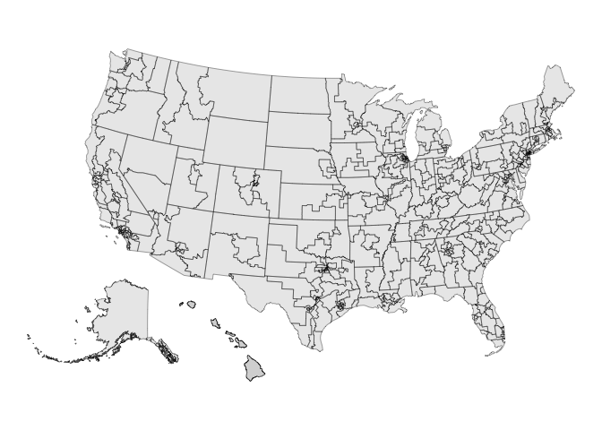

<!-- README.md is generated from README.Rmd. Please edit that file -->

# fourthirtyfive

<!-- badges: start -->

[](https://github.com/kuriwaki/fourthirtyfive/actions/workflows/R-CMD-check.yaml)
<!-- badges: end -->

Maintainer: Shiro Kuriwaki

Contributors: Zoya Ahmer, Zachary Donnini, Cory McCartan

Copyright holders: Downballot (some data)

`fourthirtyfive` is a package that provides shapefiles and other data
for the 435 congressional districts, gathering good ideas from various
authors. The current data cover 2006-2027.

## Installation

You can install the development version of fourthirtyfive from
[GitHub](https://github.com/) with:

``` r
# install.packages("devtools")
remotes::install_github("kuriwaki/fourthirtyfive")
```

## Example

Use the `cd_` accessors to retrieve district data. Type `cd_` in RStudio
to discover the family with autocomplete.

``` r
library(fourthirtyfive)
```

| Accessor          | Returns                                             |
|-------------------|-----------------------------------------------------|
| `cd_boundaries()` | Geographic district boundaries as an `sf` object    |
| `cd_dotmap()`     | Dodged district points as an `sf` object            |
| `cd_hexmap()`     | District hex cartograms as an `sf` object           |
| `cd_names()`      | Descriptive geographical district names as a tibble |
| `cd_available()`  | A CLI summary and an invisible availability table   |

Check the available products and periods without downloading any maps:

``` r
cd_available()
#>
#> ── Available congressional district data ──
#>
#> • `cd_boundaries()`: 1789-2027 (Congresses 1-120); Lewis / US Census.
#> • `cd_dotmap()`: 2005-2027 (Congresses 109-120); Lewis / US Census, dodged centroids.
#> • `cd_hexmap()`: 2005-2027 (Congresses 109-120); hexmap / The Downballot.
#> • `cd_names()`: 2005-2027 (Congresses 109-120); Daily Kos / The Downballot /
#>   contributors.
#> Years refer to the start of a Congress, not its election year.
#> Historical hexmaps for 2005-2011 reuse the generated 2009 map.
```

Use `cd_available(quiet = TRUE)` to get just the table. The original
`load_cd_shps()`, `load_shp_dot()`, `load_shp_hex()`, and
`load_cd_info()` functions remain available as compatibility wrappers.

We are building several types of maps. First, the **dotmap** is where
one CD is treated as point. We use the centroid of the actual map, and
dodge it so that crowded points do not completely overlap with each
other.

``` r
library(sf)
#> Linking to GEOS 3.13.0, GDAL 3.8.5, PROJ 9.5.1; sf_use_s2() is TRUE
library(ggplot2)

cd_dotmap(2023) |>
  ggplot() +
  geom_sf(data = shp_states) +
  geom_sf(size = 1, alpha = 0.5) +
  theme_void()
```


For now, the output of each function for recent years is stored as a
package dataset as well:

``` r
shp_dot_2023
#> Simple feature collection with 435 features and 2 fields
#> Geometry type: POINT
#> Dimension:     XY
#> Bounding box:  xmin: -2288151 ymin: 118141.6 xmax: 2073753 ymax: 3105727
#> Projected CRS: NAD83 / Conus Albers
#> First 10 features:
#>    cong    cd                  geometry
#> 1   118 AK-01 POINT (-1935091 654711.3)
#> 2   118 AL-01 POINT (780145.2 921677.4)
#> 3   118 AL-02  POINT (934714.7 1007996)
#> 4   118 AL-03  POINT (947758.5 1172320)
#> 5   118 AL-04  POINT (799973.5 1270900)
#> 6   118 AL-05  POINT (852955.2 1339883)
#> 7   118 AL-06  POINT (851197.4 1185212)
#> 8   118 AL-07  POINT (783499.7 1078747)
#> 9   118 AR-01  POINT (421002.1 1377139)
#> 10  118 AR-02  POINT (328419.7 1351219)
```

We also provide **hexmaps** (i.e., maps that present CDs as combinations
of hexagons) for all years. The 2013-2025 maps are sourced from the
Downballot’s hex map shapefiles (<https://the-db.co/maps>). The
2005-2011 maps are generated with Cory McCartan’s
[hexmap](https://github.com/CoryMcCartan/hexmap) package.

``` r
cd_hexmap(2023) |>
  ggplot() +
  geom_sf() +
  theme_void() +
  labs(caption = "Map Source: https://the-db.co/maps")
```


Note: An earlier version of these hex maps was provided in the
[`donnermap`](https://github.com/kuriwaki/donnermap) package. Those
shapefiles used unprojected coordinates that do not match the coordinate
system of the other hex maps here. The hex maps in `fourthirtyfive` use
the projected Web Mercator versions (`wm` suffix) from the Downballot.

We do not store actual CD shapefiles, but we provide a function to draw
these from either the Census or Jeff Lewis’s historical shapefiles.

Use `cd_boundaries(year = 2027)` for the 120th Congress. The nine states
redrawn for the 2026 election use Census’s 2026 TIGER/Line boundaries,
simplified together for plotting by default; all other states, including
Missouri, retain the 2025 map. Use `simplify = FALSE` for full detail in
the nine redrawn states. The assembled 2027 map is cached within the R
session; use `cache = FALSE` to rebuild it.

``` r
cd_shps <- cd_boundaries(congress = 118)
```

``` r
cd_shps |>
  ggplot() +
  geom_sf() +
  theme_void()
```



We also provide a dataset of the **descriptive names** of each district
(e.g., calling AZ-01 in the 110th congressional district “Phoenix
exurbs, Prescott, and Flagstaff”). These use [Daily
Kos](https://www.dailykos.com/stories/2022/8/8/2113098/-The-Daily-Kos-Elections-naming-guide-to-this-decade-s-new-congressional-districts)
namings. Zachary Donnini named 2008-2010 congressional districts.

``` r
cd_names(2007)
#> # A tibble: 435 × 3
#>     cong cd    cd_description                                
#>    <dbl> <chr> <chr>                                         
#>  1   110 AK-01 All of Alaska                                 
#>  2   110 AL-01 Southern Alabama                              
#>  3   110 AL-02 Southeast Alabama                             
#>  4   110 AL-03 East-central Alabama                          
#>  5   110 AL-04 North-central Alabama                         
#>  6   110 AL-05 Northern Alabama                              
#>  7   110 AL-06 Birmingham and Tuscaloosa suburbs             
#>  8   110 AL-07 Birmingham, Tuscaloosa, and western Black Belt
#>  9   110 AR-01 Northeastern Arkansas                         
#> 10   110 AR-02 Greater Little Rock                           
#> # ℹ 425 more rows
```

This can be loaded as an object too, for now:

``` r
info_2007
```

## Data format

We name the datasets (`shp_dot_**`, `info_**`) by the year of the
congress.

| Object    | Congress | Years in Session | Year Elected | Year up for Election |
|-----------|----------|------------------|--------------|----------------------|
| `**_2005` | 109th    | 2005-2006        | 2004         | 2006                 |
| `**_2007` | 110th    | 2007-2008        | 2006         | 2008                 |
| `**_2009` | 111th    | 2009-2010        | 2008         | 2010                 |
| `**_2011` | 112th    | 2011-2012        | 2010         | 2012                 |
| `**_2013` | 113th    | 2013-2014        | 2012         | 2014                 |
| `**_2015` | 114th    | 2015-2016        | 2014         | 2016                 |
| `**_2017` | 115th    | 2017-2018        | 2016         | 2018                 |
| `**_2019` | 116th    | 2019-2020        | 2018         | 2020                 |
| `**_2021` | 117th    | 2021-2022        | 2020         | 2022                 |
| `**_2023` | 118th    | 2023-2024        | 2022         | 2024                 |
| `**_2025` | 119th    | 2025-2026        | 2024         | 2026                 |
| `**_2027` | 120th    | 2027-2028        | 2026         | 2028                 |
